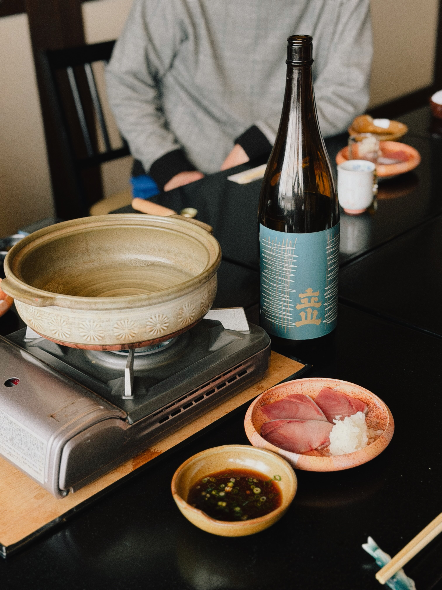
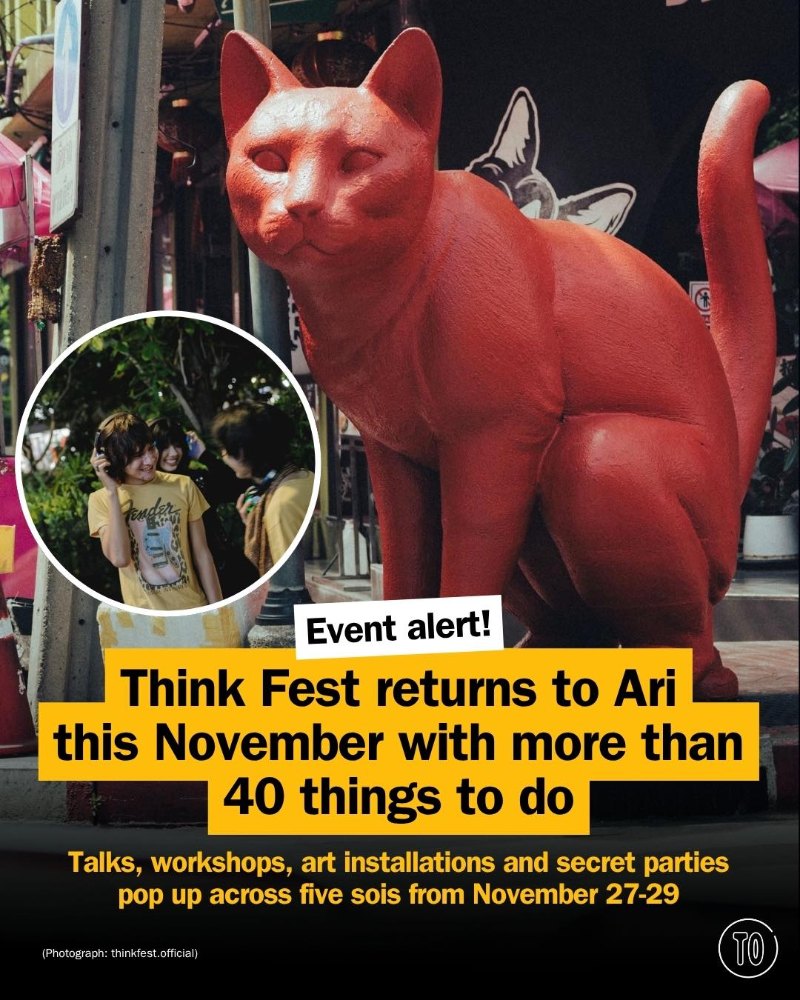
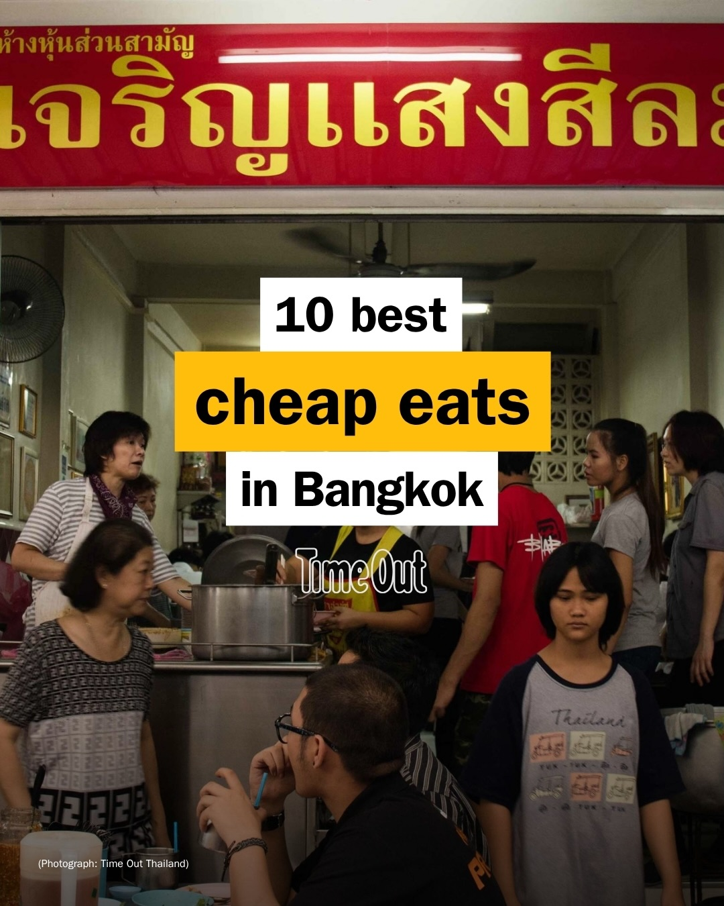

# 📸 2026-10-25 IG 新貼文彙整

## @jiranarong2 · 展覽

**摘要：** （分析失敗：Unexpected token 'O', "OK
" is not valid JSON）

> น่าจะโพสต์สุดท้ายของเมือง Toyama ละครับ จนกว่าจะกลับไปพบกันใหม่ ต่อไปจะเข้าสู่เมือง Kanazawa แล้ว ร้านนี้อยากแนะนำสำหรับคนที่ขับรถเที่ยว มัน…

🔗 https://www.instagram.com/p/De4U_afk_LK/

---

## @jiranarong2 · 展覽

**摘要：** （分析失敗：Unexpected token 'O', "OK
" is not valid JSON）

> ไปแล้วไม่ค่อยเห็นอะไร แต่นั่นเป็นเรื่องดี 😆 และคนที่แปะหน้า🐻 ไม่ใช่หนู

🔗 https://www.instagram.com/p/De33BNwTng8/

---

## @lifestyleasiath · 旅遊

**摘要：** （分析失敗：Unexpected token 'O', "OK
" is not valid JSON）

> From the latest Fall/Winter collections to some fabulous collabs, here are our #WeeklyObsessions this week. #Fashion #Beauty #Watches #Lifes…

🔗 https://www.instagram.com/p/De5shNRCP86/

---

## @timeoutbangkok · 市集

**摘要：** （分析失敗：Unexpected token 'O', "OK
" is not valid JSON）

> No plans for the last weekend of November? Think Fest returns to Ari from November 27-29, spreading more than 40 activities across five sois…

🔗 https://www.instagram.com/p/De5vmgBj86U/

---

## @timeoutbangkok · 市集

**摘要：** （分析失敗：Unexpected token 'O', "OK
" is not valid JSON）

> This Halloween, Kimpton Maa-Lai Bangkok (@kimptonmaalaibangkok) gives you two good reasons to get into the spooky spirit: Bar.Yard’s (@bar.y…

🔗 https://www.instagram.com/p/De4FhEhExGM/

---

## @timeoutbangkok · 市集

**摘要：** （分析失敗：Unexpected token 'O', "OK
" is not valid JSON）

> Light on the wallet, scattered across the city and genuinely good 🍚🍗🍜 From 40-year beef broth in Ekkamai to railway-side red pork rice in…

🔗 https://www.instagram.com/p/De3czg1E93G/

---

