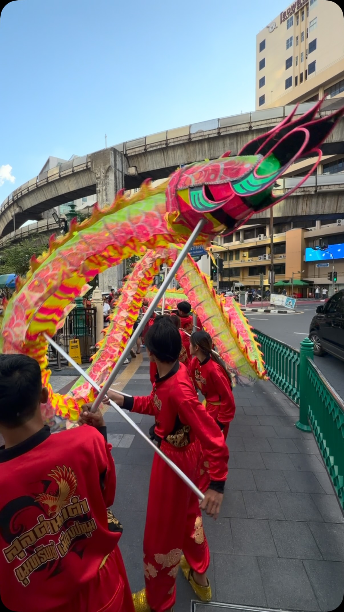
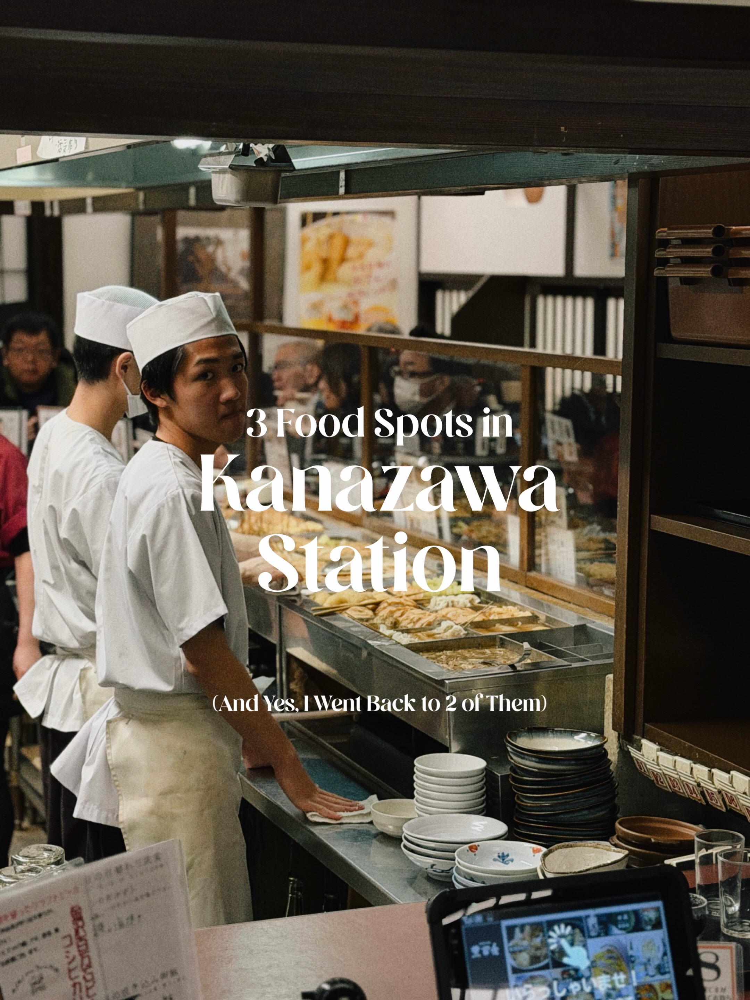
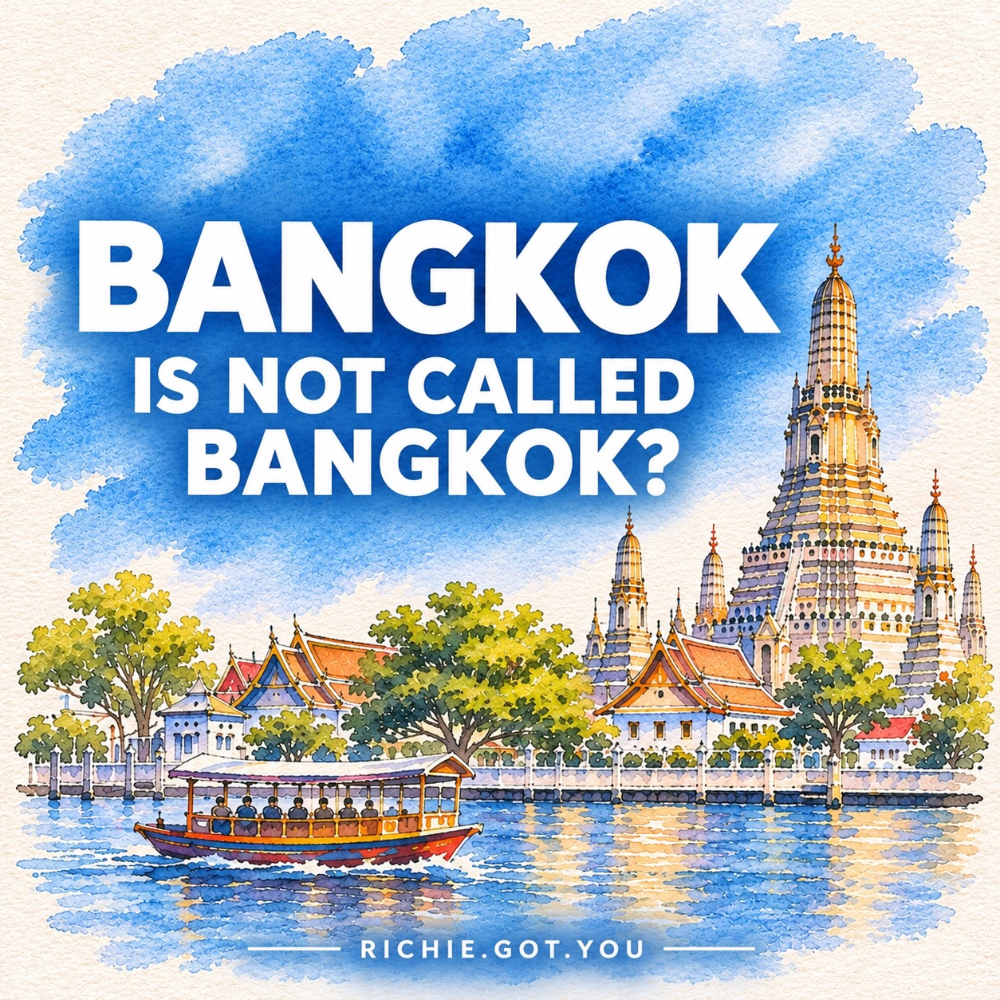
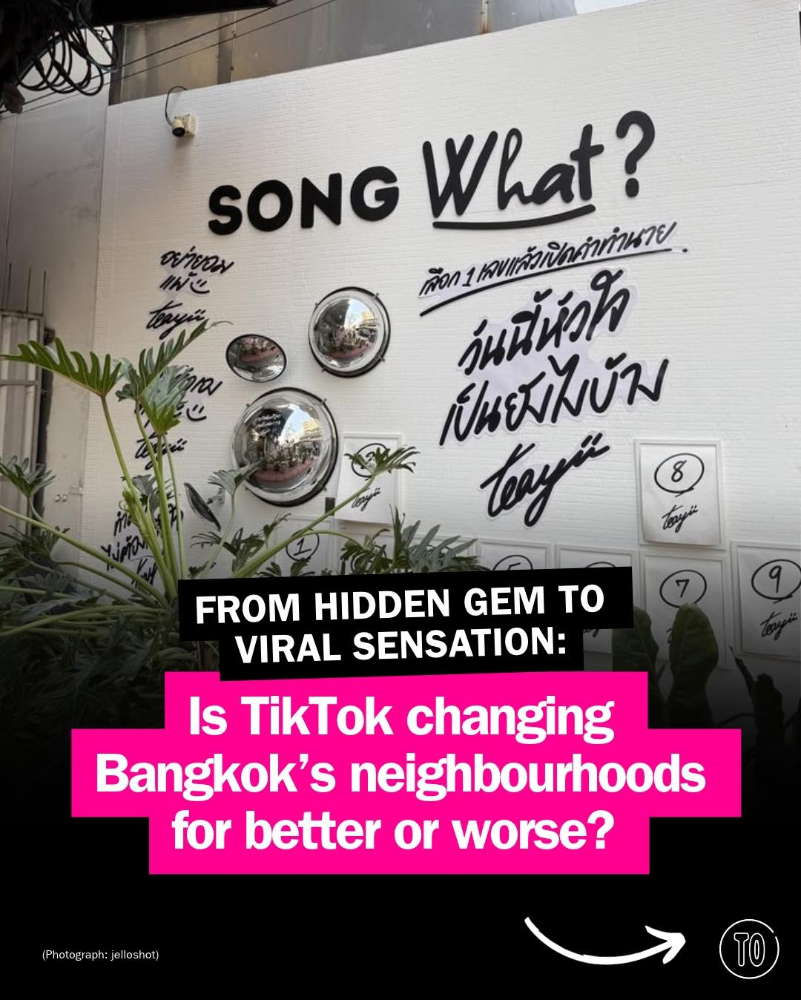
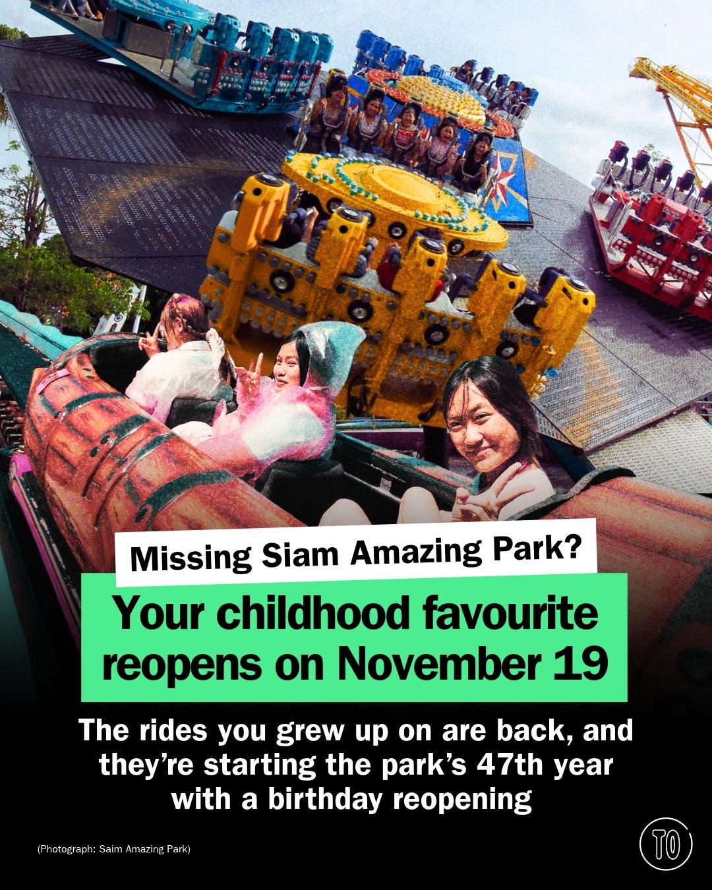

# 📸 2026-11-09 IG 新貼文彙整

## @bangkok_insiders · 展覽

**摘要：** （分析失敗：Unexpected token 'O', "OK
" is not valid JSON）

> LV visionary journeys | A Journey Through Fashion, Art & Luxury Discover the world of Louis Vuitton through an immersive exhibition celebrat…

🔗 https://www.instagram.com/p/DffBUlchnPw/

---

## @bangkok_insiders · 展覽

**摘要：** （分析失敗：Unexpected token 'O', "OK
" is not valid JSON）

> Dragon dancing at Erawan shrine Bangkok #bangkok #bkk #bkk #amazing #travel

🔗 https://www.instagram.com/p/Dfec_JTPLPm/

---

## @jiranarong2 · 展覽

**摘要：** （分析失敗：Unexpected token 'O', "OK
" is not valid JSON）

> ผมไปคานาซาวะ 3 รอบ แต่กินข้าวในสถานีคานาซาวะเยอะที่สุด ต่อให้ไปเดินเล่นในเมืองก็กลับมากินที่สถานี แล้วร้านในสถานีที่มีเยอะมาก ก็เลือกกินซ้ำๆ…

🔗 https://www.instagram.com/p/DfelqCFEws7/

---

## @richie.got.you · 旅遊

**摘要：** （分析失敗：Unexpected token 'O', "OK
" is not valid JSON）

> BANGKOK is not called Bangkok? 🤔 💡Did you know Bangkok has a full name? #bangkok #bangkokthailand #bangkokthailand #thailand

🔗 https://www.instagram.com/p/DfedyuEmWnB/

---

## @lifestyleasiath · 旅遊

**摘要：** （分析失敗：Unexpected token 'O', "OK
" is not valid JSON）

> Who can deny the power of yadom? And who hasn’t felt the burn of a hot cup of nam khing? In no particular order, and with a mini commentary …

🔗 https://www.instagram.com/p/DfgNiADClmz/

---

## @lifestyleasiath · 旅遊

**摘要：** （分析失敗：Unexpected token 'O', "OK
" is not valid JSON）

> Jewellery, candles, handbags, and one foldable phone take over our #WeeklyObsessions this week. It’s time to start prepping those holiday wi…

🔗 https://www.instagram.com/p/DfeLDZpinia/

---

## @timeoutbangkok · 市集

**摘要：** （分析失敗：Unexpected token 'O', "OK
" is not valid JSON）

> From TikTok-famous cafés to decades-old family businesses, Bangkok's historic streets are attracting a whole new crowd. But as social media …

🔗 https://www.instagram.com/p/Dfgokpij5UG/

---

## @timeoutbangkok · 市集

**摘要：** （分析失敗：Unexpected token 'O', "OK
" is not valid JSON）

> Who grew up riding the 🎠 at Siam Park? The roller coaster, the giant rainbow slide, the haunted house you swore you weren’t scared of. For …

🔗 https://www.instagram.com/p/DfgiD8BD9cN/

---

## @timeoutbangkok · 市集

**摘要：** （分析失敗：Unexpected token 'O', "OK
" is not valid JSON）

> Who else grew up with Elmo? Good news, because he and his Sesame Street mates move in at Central Embassy this festive season, a first for Th…

🔗 https://www.instagram.com/p/Dfef39kD07t/

---

## @timeoutbangkok · 市集

**摘要：** （分析失敗：Unexpected token 'O', "OK
" is not valid JSON）

> One person’s clear-out is another’s find of the year. Bangkok’s vintage scene runs from blocstore’s designer archives at Lido Connect to ban…

🔗 https://www.instagram.com/p/DfeRRfxk5Kd/

---

